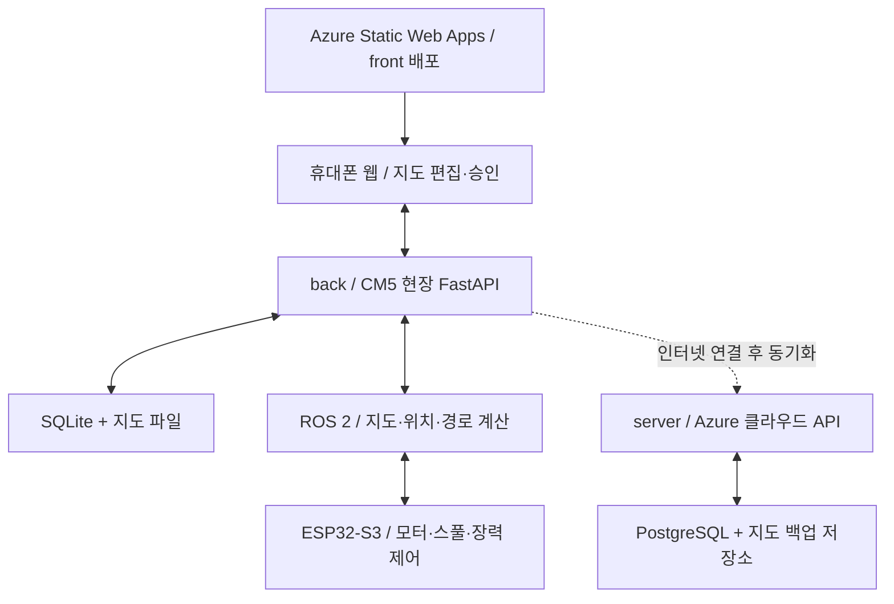

<div align="center">

# CableWorm
### 은폐공간 탐색과 견인선 설치를 위한 케이블 로봇

탐색으로 지도를 만들고, 사용자가 경로를 승인하면 로봇이 견인선을 설치합니다.

[프로젝트 구조](#프로젝트-구조) · [개발 계획](#개발-계획) · [Azure 배포 가이드](server/AZURE_SETUP.md)

**설계 단계 · 초기 저장소 구성 완료 · 로봇 기능 구현 예정**

</div>

---

## 프로젝트 소개

CableWorm은 인터넷 연결이 어려운 공간에서 주변을 탐색하고, 사용자가 승인한 경로를 따라 견인선을 설치하는 로봇 프로젝트입니다. 현장 작업은 로봇 내부에서 수행하며, 클라우드는 인터넷 연결 후 이력 조회와 백업을 담당합니다.

> 이 문서의 기능과 기술 조합은 제공된 구현 제안 발표자료를 바탕으로 한 개발 계획입니다. 현재 저장소에는 폴더 구성, 문서, 배포 확인용 정적 페이지와 Azure 설정이 포함되어 있습니다. 지도 편집기·API·로봇 제어는 아직 구현하지 않았습니다.

## 작업 흐름

1. **1차 주행 — 탐색**: 견인선을 풀지 않고 지도를 생성한 뒤 출발점으로 복귀합니다.
2. **현장 연결**: 휴대폰을 로봇 Wi-Fi에 연결하고 저장된 지도를 확인합니다.
3. **경로 선택과 승인**: 사용자가 희망 경로를 그리면 로컬 계획기가 장애물·로봇 폭·꺾임을 고려해 보정합니다. 원본과 보정 결과를 비교한 뒤 승인합니다.
4. **2차 주행 — 설치**: 재투입 위치와 지도 버전을 확인한 뒤 견인선을 설치하고 결과를 기록합니다.

## 프로젝트 구조

```text
cable_robot/
├── local/                       # 장치: CM5 현장 API, 로컬 저장·ROS 2 연결
├── front/                      # 프론트엔드: 웹 화면
│   └── public/                 # 현재 Azure에 배포하는 정적 소개 페이지
├── server(back)/                     # 클라우드 API 계획·Azure 인프라
│   ├── infra/static-web-app.bicep
│   └── AZURE_SETUP.md           # Azure 생성·GitHub 연결 절차
└── .github/workflows/
    └── azure-static-web-apps.yml
```

| 영역 | 실행 위치 | 예정 역할 / 기술 |
| --- | --- | --- |
| [back](back/README.md) | 로봇 CM5 | FastAPI, WebSocket, SQLite, 지도 파일, ROS 2 연결 |
| [front](front/README.md) | 휴대폰 브라우저 | React, TypeScript, Vite, react-konva, Zustand, TanStack Query |
| [server](server/README.md) | Azure | FastAPI 클라우드 API, PostgreSQL, 작업 이력·지도 백업 |
| 로봇 판단·제어 | CM5 / ESP32-S3 | ROS 2 Jazzy, RTAB-Map, robot_localization, Nav2 / ESP-IDF, FreeRTOS |

하드웨어 모델과 센서 처리 성능, 경로·위치 오차 및 장력 제한값은 실험 후 확정합니다. 로봇 펌웨어와 ROS 2 패키지의 상세 경로는 개발 착수 시 정합니다.

## 실행 구조



**현장 오프라인 운영:** 완성된 웹 빌드도 CM5에서 제공해야 합니다. Azure 사이트만으로는 인터넷이 없는 휴대폰의 최초 접속을 보장하지 못합니다. 현장에서는 CM5가 웹과 API를 같은 출처로 제공하는 구성을 우선합니다. Azure HTTPS 페이지에서 로봇의 로컬 HTTP API에 직접 연결하는 방식은 혼합 콘텐츠·CORS·브라우저 로컬 네트워크 정책을 별도로 검증해야 합니다.

Static Web Apps는 프론트 배포 대상입니다. CM5 프로세스·ROS 2·ESP32 펌웨어나 일반 FastAPI 서버를 이 워크플로로 실행하지 않습니다.

## 통합 데이터 계약 — 구현 예정

| 대상 | 공유할 정보 |
| --- | --- |
| 지도 | `map_id`, `version`, `origin`, `resolution` |
| 경로 | 원본 점, 보정 점, 필수 경유점 |
| 승인 | `plan_hash`, `job_id`, 장치의 저장 완료 응답 |
| 상태 | 탐색 중, 대기, 설치 중, 완료, 오류 |

지도 좌표는 미터 단위로 다루고 픽셀 좌표와의 변환 규칙을 맞춥니다. 승인 요청 수신, 저장 완료, 실제 설치 완료는 구분합니다. 재접속 시 로봇 상태를 다시 조회하고, 지도 버전 불일치나 재위치 실패 시 설치를 시작하지 않도록 구현합니다.

## 개발 계획

- [x] back / front / server 구조와 역할 문서화
- [x] Azure 배포 확인용 정적 페이지와 GitHub Actions 준비
- [ ] Azure Static Web App 생성 및 배포 토큰 연결
- [ ] **통합 시연 1**: 가짜 지도에서 경로 그리기 → 보정 → 승인 저장
- [ ] **통합 시연 2**: 실제 센서 지도 생성 → 복귀 → 재투입 위치 확인
- [ ] **통합 시연 3**: 승인 경로 주행 → 스풀 장력 제어 → 설치 결과 기록
- [ ] 클라우드 동기화, 작업 이력 조회와 지도 백업

## 협업

`feat/기능명`, `fix/수정내용`, `docs/문서명` 브랜치에서 작업하고 PR에 변경 내용과 확인 방법을 적기. 실제 지도, 현장 이미지, DB 파일과 비밀키는 저장소에 올리기 X
